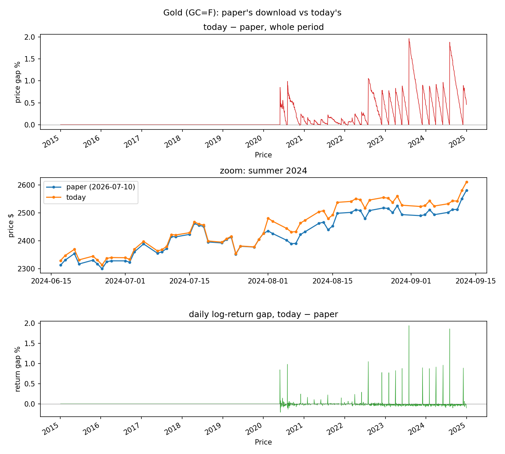

# Reproducing the paper's results

The repository contains the code, the configuration of every run, the results and the
paper's tables. It does **not** contain the market and macro series, nor the files that
hold them in another form (returns, windows, the real-pair label files, the LLM prompts):
the providers' terms do not allow redistributing them. They are downloaded and recomputed with the commands below.

**What is included and needs no recomputation:** the synthetic data and the trained models
of the paper's classifier (`data/processed/runs/main_minw0/`: DDPM weights and samples,
labelled transfer sets, classifier weights), the thresholds, and the Fed yield-curve
snapshot (`data/raw/feds200628.csv.gz`).

Every result lands in `results/runs/<run>/`; `results/README.md` says which run is which.
Steps marked **[ENGINE]** need the Temporal Vadalog reasoner; everything else is Python.

## What needs the reasoner, and how to check it without one

Temporal Vadalog
([Theory and Practice of Logic Programming](https://www.cambridge.org/core/journals/theory-and-practice-of-logic-programming/article/temporal-vadalog-system-temporal-datalogbased-reasoning/2AF9E4F68FF09B5970EBB4C0790AB624))
is not openly available. The results split as follows:

| | needs the reasoner? |
|---|---|
| labels, rules, scores, confidence intervals, classifier, simulation, all rule tables | **no**: Python (the Python labeller implements the same DatalogMTL definitions) |
| rule verification (Python vs reasoner confidence) | yes |
| label agreement, Python vs reasoner, on the real test windows | no, with the included reasoner labels (section 2) |
| classifier fidelity on the real test windows (the reasoner's labels are the targets) | no, with the included reasoner labels (section 1) |
| speed of the reasoner | no, from the included timing (section 2); yes to remeasure it |

**The verification can be inspected without running the engine.** For every verified rule
of the run `main`, the repository contains what the engine received and what it returned,
in `data/processed/runs/main/verification/<date>/<rule>_<pair>_test/`:

- `<rule>_<pair>_test.vada`: the DatalogMTL program the engine ran (the rule as reported);
- `edb_<predicate>.csv`: the facts it was given, i.e. predicate intervals on the test
  period (`X,Y,Start,End`), no prices;
- `<head>_<rule>_<pair>_test.csv`: the engine's output, the days on which the rule's head
  holds.

The reasoner's confidence in `results/runs/main/verification.csv` (`vadalog_confidence`)
is the share of condition days on which the engine's head holds; the `artifacts` column
names each rule's folder. `verification_summary_filtered.md` in the same folder sums it up
for the reported pairs.

---

## 0. Setup (once)

```bash
python3.13 -m venv .venv && source .venv/bin/activate
pip install -r requirements-frozen.txt
export FRED_API_KEY='...'     # free key: https://fred.stlouisfed.org/docs/api/api_key.html
```

For the [ENGINE] steps: start the Vadalog engine with its repository set to this folder
(README, Setup).

## 1. The paper's results (run `main`), Python only

Uses the included classifier, so the numbers match the paper's tables.

```bash
R=main
P=sp500_gold,sp500_bitcoin,sp500_ust10y,sp500_tlt,sp500_ust10z

python scripts/data_prep.py -d all --run $R          # downloads the series, builds the windows
python scripts/prep_real_pairs.py -p $P --run $R     # exact labels + macro state
python scripts/infer.py -p $P --run $R               # classifier labels
python scripts/paper.py results --no-engine --run $R # rules, multiple testing
python scripts/paper.py tables --run $R
python scripts/paper_final.py                        # the paper's tables -> paper_tables/
```

**Check your download against the paper's data** (no data is shared, only fingerprints):

```bash
python scripts/raw_checksums.py --check
```

It reports, per series, whether the download is identical to the paper's copy and, if
not, from which year it differs. Known differences (checked on 2026-11-11):

- **S&P 500, Bitcoin, US CPI:** identical; the rules on these series reproduce exactly.
  The 10-year zero-coupon series is the included Fed file, so it is identical too.
- **TLT:** the adjusted prices are rescaled by the provider, but the daily returns differ
  by less than $5\cdot10^{-6}$; only the training confidence of five rules changes (by
  0.01), the test results are identical.
- **Gold (COMEX futures, `GC=F`):** the provider has rebuilt the series from 2020 onwards
  since the paper's download (2026-07-10). With the revised series the gold rules change;
  T2 on gold stays positive (lift 0.22 instead of 0.45) but is no longer significant;
  T7b on gold becomes significant (lift 0.26); T4 and T4b on gold become negligible. The paper's copy cannot be redistributed; the data are available from the
  authors upon request.

  

  *Top: price gap (later − paper's) in %, 2015–2024: zero until 2019, then nonzero on
  almost every day. Middle: the two series in summer 2024, where the gap is largest.
  Bottom: gap in daily log returns, which is what changes the labels.*

## 2. Fidelity, label agreement and speed from the included reasoner outputs (no engine)

The repository includes, for the run `main`, what these steps read from the reasoner:
its labels of the real test windows (`data/processed/runs/main/real_test_*/`: regime,
highVol, lowVol and tailDependent intervals) and its timing (`_timing/timing.json`,
`_warmup/timing.json`). Section 1's `paper.py results --no-engine` already scores the
classifier fidelity against them. Then:

```bash
# label agreement, Python vs reasoner
for p in sp500_gold sp500_tlt sp500_ust10z sp500_ust10y; do
  python scripts/eval.py --metric agreement --pair $p --step 5 --run $R
done
python scripts/eval.py --metric agreement --pair sp500_bitcoin --step 10 --run $R

# speed: rebuild the timed window-pairs (no engine), then time the classifier on them
python scripts/prep_real_pairs.py -p sp500_bitcoin,sp500_gold --engine vadalog --batches-only --run $R
python scripts/classifier_timing.py --run $R
python scripts/timing_table.py --run $R

python scripts/paper_final.py
```

The reasoner's own seconds come from the included `timing.json`; the classifier's are
measured on your machine, so the speed-up depends on it.

The included reasoner labels were computed on the paper's data. With a gold series
downloaded after 2026-07-10, the gold agreement compares the reasoner's labels of the
paper's series with the Python labels of the revised one, and is therefore lower (129/141
instead of 141/141 in a test rerun). This reflects the different input data, not a
disagreement between the two labellers: on the same data they agree on 141/141. For a
like-for-like comparison on the revised series, rerun the reasoner on it (§2b).

### 2b. [ENGINE] Rerunning the reasoner

Overwrites the included reasoner outputs with your own.

```bash
# the reasoner labels the real test windows (about an hour per pair)
caffeinate -dims python scripts/eval.py --metric fidelity --dataset real --pair sp500_gold   --step 5  --label-first --run $R
caffeinate -dims python scripts/eval.py --metric fidelity --dataset real                     --step 10 --label-first --run $R   # bitcoin, for fidelity
caffeinate -dims python scripts/eval.py --metric fidelity --dataset real --pair sp500_bitcoin --step 10 --label-first --per-pair-route --run $R   # bitcoin, for agreement
caffeinate -dims python scripts/eval.py --metric fidelity --dataset real --pair sp500_ust10y --step 5  --label-first --run $R
caffeinate -dims python scripts/eval.py --metric fidelity --dataset real --pair sp500_tlt    --step 5  --label-first --run $R
caffeinate -dims python scripts/eval.py --metric fidelity --dataset real --pair sp500_ust10z --step 5  --label-first --run $R

# speed: one warm-up batch (discarded), then three timed batches
caffeinate -dims python scripts/label.py -p sp500_bitcoin --track real --engine vadalog --n-batches 1 --results data/processed/_warmup --run $R
caffeinate -dims python scripts/label.py -p sp500_gold --track real --engine vadalog --n-batches 3 --results data/processed/_timing --run $R

# rule verification on the engine, fidelity scores, then the tables
caffeinate -dims python scripts/paper.py results --run $R
python scripts/paper.py tables --run $R
python scripts/paper_final.py
```

Then rerun the agreement commands of section 2.

## 3. Simulation study

Fully synthetic: no download and no real data. The series are generated by a GARCH-based
process with the phenomenon planted (`simulation/dgp.py`), with a fixed seed per
configuration.

```bash
cd "data_simulation_econ tests/simulation"
python export_datasets.py core long        # the simulated series (fixed seeds, ~390 MB)
# optional: recompute the econometric test's rates (results_econ.csv is included)
# python mc_econ.py
cd ../..
python scripts/simulate_rules.py --jobs 4 --run main                     # 10 years (core/)
python scripts/simulate_rules.py --dir "data_simulation_econ tests/simulation/datasets/long" \
    --jobs 4 --run main                                                  # 20 and 40 years (long/)
python scripts/paper_final.py
```

## 4. Retraining the classifier from scratch (optional)

Replaces the included classifier of `main_minw0`, which `main` uses. The DDPM and the
classifier are seeded, but retraining gives a different classifier: in a test rerun, 40 of
the 60 classifier-label rule results changed, and so did some verdicts. To reproduce the
paper's classifier results, use the included classifier (section 1).

```bash
R=main_minw0
P=sp500_gold,sp500_bitcoin,sp500_ust10y,sp500_tlt,sp500_ust10z
python scripts/data_prep.py -d all --run $R
for s in SP500 Gold Bitcoin UST10Y TLT UST10Z; do python scripts/synthesize.py -d $s --run $R; done
python scripts/build_realistic_transfer.py -p $P --strength boundary --run $R
python scripts/distill.py --pairs $P --transfer-suffix _boundary --seed 42 \
    --save data/processed/classifier_v7p3_s42.pt --force --run $R
```

Then repeat sections 1–2 for `main`.

## 5. Sensitivity and robustness runs (window 25 / 100, second test period)

Each run trains its own DDPM and classifier (except `window25_minw0`, which reuses
`window25`'s). Python only; the engine steps are optional, as in section 2.

```bash
# the pairs of a run, and the series they use (from the run's configuration)
pairs()  { python -c "from tslearning.config import load_config; print(','.join(load_config(run='$1')['paper']['pairs']))"; }
series() { python -c "from tslearning.config import load_config; from tslearning.datasets.pairs import describe; p=load_config(run='$1')['paper']['pairs']; print(' '.join(dict.fromkeys(x for q in p for x in (describe(q)['a'], describe(q)['b']))))"; }

# DDPM, transfer sets and classifier: every run except window25_minw0 (reuses window25's)
for R in window25 window100 robust_2016-2024; do
  P=$(pairs $R)
  python scripts/data_prep.py -d all --run $R
  for s in $(series $R); do python scripts/synthesize.py -d $s --run $R; done
  python scripts/build_realistic_transfer.py -p $P --strength boundary --run $R
  python scripts/distill.py --pairs $P --transfer-suffix _boundary --seed 42 \
      --save data/processed/classifier_v7p3_s42.pt --run $R
done

# labels, rules, tables and simulation for every run
for R in window25 window25_minw0 window100 robust_2016-2024 main_minw0 main_mind20; do
  P=$(pairs $R)
  [ -f data/processed/runs/$R/windowed.pkl ] || python scripts/data_prep.py -d all --run $R
  python scripts/prep_real_pairs.py -p $P --run $R
  python scripts/infer.py -p $P --run $R
  python scripts/paper.py results --no-engine --run $R
  python scripts/paper.py tables --run $R
  python scripts/simulate_rules.py --jobs 4 --run $R
done

# the comparison tables of the robustness paragraph
python scripts/compare_runs.py -o results/compare/main_vs_robustness --runs main,robust_2016-2024
python scripts/compare_runs.py -o results/compare/windows --runs window25,main,window100
python scripts/compare_runs.py -o results/compare/min_days --runs main,main_mind20
```

## 6. LLM comparison (optional)

The LLM runs are in `results/runs/main/llm_*.json`. Sampling differs between runs, so
new runs give new rules; the saved ones are rescored with
`python scripts/llm_rules.py --rescore results/runs/main/llm_sp500_gold_*.json --run main`.
To make new ones: `scripts/llm_rules.py` (needs `ollama` and/or `ANTHROPIC_API_KEY`).

## 7. Econometric tests (`data_simulation_econ tests/`)

Download the raw series listed in `data_simulation_econ tests/README.ipynb` (§ Series)
into `data_simulation_econ tests/market_data/raw/` (one `date,value` CSV per series), then:

```bash
cd "data_simulation_econ tests"
python main.py
```
